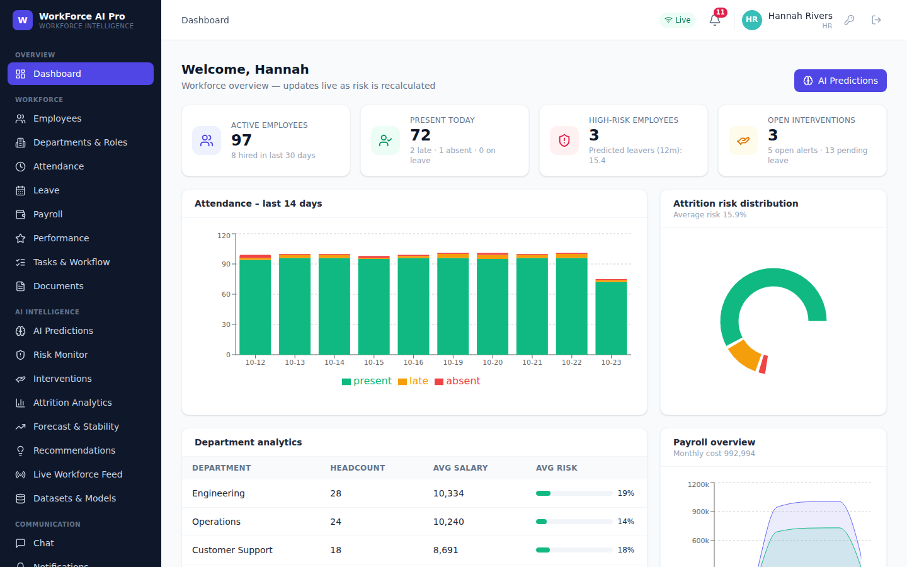

# WorkForce AI Pro – HR Attrition Prediction & Workforce Intelligence Platform

Full-stack, role-based HR platform that predicts attrition with machine learning and turns each prediction into an alert and a guided retention workflow, in real time.

**Stack:** FastAPI · MySQL · SQLAlchemy 2 · Pydantic · JWT · scikit-learn/pandas · React 18 (Vite) · Tailwind CSS · Axios · Recharts



## What it does (all 30 modules from the brief)
| Area | Modules |
|---|---|
| Foundation | Auth (register/login/JWT/refresh/forgot-reset/session validation) · Employees · Departments & roles · RBAC (Admin/HR/Manager/Employee) |
| HR operations | Attendance & shifts · Leave (policies, balances, approval) · Payroll (tax, PF, overtime, bonus, payslip PDF) · Documents · Performance & goals · Tasks/workflow |
| AI core | Dataset upload/validation/versioning · Model training & comparison · Prediction engine (risk %, confidence, drivers, department-level, history) · What-if simulator |
| Real-time intelligence | Risk monitor & change tracking · Alerts with priority · HR intervention workflow · Live workforce feed (WebSocket) · Instability detection |
| Analytics | Dashboards per role · Attrition analytics · Forecast & growth projection · Department stability scores · AI recommendations |
| Platform | Notifications · Chat with read receipts · Advanced search/multi-filter · Reports (Excel/PDF/CSV) · Audit logs |

The brief's expected flow is implemented as one pipeline and covered by an end-to-end test — see `docs/ARCHITECTURE.md` §2.

## Quick start

### Option A – Docker (MySQL + API + UI)
```bash
docker compose up --build            # UI http://localhost:8080 · API http://localhost:8000/docs
docker compose exec api python -m scripts.seed --reset
```
> The compose file was written but **not executed** in the build environment (no Docker daemon). The manual path below was run and tested.

### Option B – Manual
```bash
# 1. MySQL
mysql -uroot -p < database/schema.sql          # or let the app create tables automatically
# 2. Backend
cd backend && python -m venv .venv && source .venv/bin/activate
pip install -r requirements.txt
cp .env.example .env                           # set DATABASE_URL (SQLite works for a zero-setup demo)
python -m scripts.seed --reset                 # demo org, 3,000-row dataset, trained model, risk history
uvicorn app.main:app --reload                  # http://localhost:8000/docs
# 3. Frontend
cd ../frontend && npm install && npm run dev   # http://localhost:5173 (proxies /api and WebSocket)
```
**Demo accounts**

| Role | Email | Password |
|---|---|---|
| Admin | admin@workforce.ai | Admin@123 |
| HR | hr@workforce.ai | Hr@12345 |
| Manager | manager@workforce.ai | Manager@123 |
| Employee | employee@workforce.ai | Employee@123 |

**See the flow live:** sign in as HR → *Risk Monitor* → *Simulate activity* → pick an employee near the threshold → apply *Satisfaction drop*. Watch the risk jump, the toast alert arrive over WebSocket, the watchlist update, and an AI-generated intervention appear under *Interventions*.

## Project layout
```
backend/   app/{routers,services,models.py,schemas.py,security.py,ws.py}  ml/synthetic.py  scripts/{seed,export_schema}.py  tests/
frontend/  src/{pages,components,context,hooks,api.js}
database/  schema.sql (MySQL DDL)            sample_data/  hr_attrition_sample.csv (upload it in the UI)
docs/      API.md · openapi.json · ARCHITECTURE.md · ERD.md · TEST_RESULTS.md · screenshots/ · sample_reports/
```

## Deliverables checklist
| Deliverable | Where |
|---|---|
| Backend source | `backend/` |
| Frontend source | `frontend/` |
| AI prediction APIs | `/api/ai/*`, `/api/datasets/*`, `/api/models/*` (`docs/API.md`) |
| Workforce dashboards | Dashboard, Risk Monitor, Attrition, Forecast pages |
| Analytics reports | `docs/sample_reports/` (PDF/XLSX/JSON generated from the running API) |
| UI screenshots | `docs/screenshots/` (captured from the running app) |
| API documentation | `docs/API.md` (128 endpoints + WebSocket), Swagger at `/docs`, `docs/openapi.json` |
| Database schema | `database/schema.sql`, `docs/ERD.md` |
| Test results | `docs/TEST_RESULTS.md` |

## Tests
```bash
cd backend && pytest -q                                                   # SQLite in-memory
TEST_DATABASE_URL="mysql+pymysql://user:pw@127.0.0.1/workforce_ai" pytest -q   # real MySQL/MariaDB (drops & recreates tables!)
```
36 tests, all passing on SQLite and on MariaDB 10.11.

## Honest notes
* **The model is trained on synthetic data** (IBM-HR-style, generated by `backend/ml/synthetic.py`). Reported accuracy (ROC-AUC 0.89, accuracy 84.7% vs 81.7% baseline) demonstrates the pipeline, not performance on real employees. Upload your own CSV (IBM HR dataset column names are auto-recognised) to retrain.
* Attrition prediction affects people; treat scores as decision support, review drivers, and follow your local HR/privacy rules. Employees never see risk scores.
* Single-node pieces (login throttle, cache, WebSocket manager) need Redis to scale horizontally — see `docs/ARCHITECTURE.md`.
* The 5-day schedule and daily commits are yours to run; the git history here is organised by feature area, not by calendar day.
